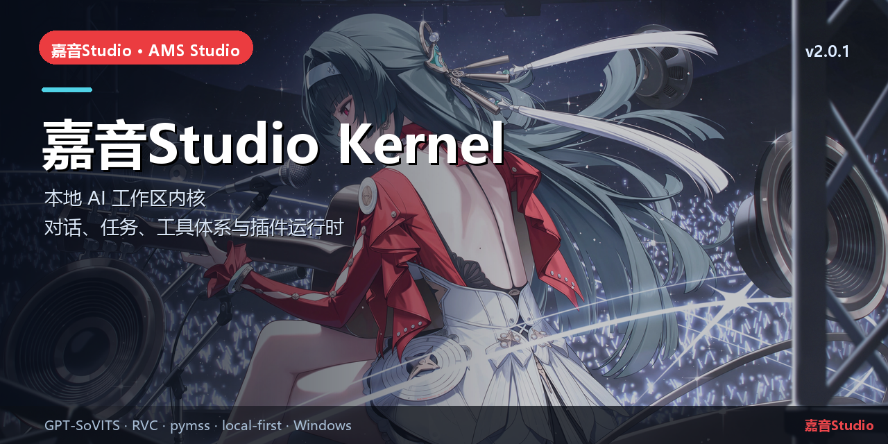

# 嘉音Studio Kernel（ams-harness）

> 本地 AI 工作区内核 · 对话、任务、工具体系与插件运行时


## 简介

嘉音Studio Kernel 基于 **DeepSeek Harness（DSH）** 的 MIT 代码构建，提供完全本地的 AI 工作区：
不需要登录，会话工作目录固定到安装目录 `data/`，通过 Cordis 插件加载音乐工作台与音乐 Agent。

上游：<https://github.com/deepseek-ai/deepseek-harness>（MIT）。本仓库保留上游历史，并在其上维护嘉音Studio的品牌、构建与插件适配。

## 核心能力

- 本地 Kernel 进程 + Web GUI，工作目录在 `data/`，不写 C 盘用户数据。
- Cordis Host/Client 插件体系，支持音乐工作台、Agent 工具、Skill、壁纸与“音乐制作”模式。
- Gateway / 工具调用 / 本地 ASR 的桥接由配套仓库提供。
- 发布内核组件：`kernel.ams.dsh 0.2.1-rc.3`（以 ams-release feed 为准）。

## 本仓库

当前仓库是 DSH 上游 monorepo 的 fork；嘉音Studio 自有改动集中在 `branding/`、插件适配、构建与发布配置。
源码体积较大，`node_modules/`、`apps/desktop/.desktop-build/` 属于本地构建缓存，不在版本控制中。

## 快速开始

```powershell
# 需要 Node.js + pnpm；依赖安装后
pnpm install
pnpm -C apps/desktop build
# 或由 ams-launcher 自动安装/启动 Kernel
```

## 相关链接

- 总仓库：[yan-mc/AMS-Studio](https://github.com/yan-mc/AMS-Studio)
- 最新发布：[yan-mc/ams-release releases](https://github.com/yan-mc/ams-release/releases)
- 当前版本：**嘉音Studio v2.0.1**（feed 2058）
- 文档：[ams-docs](https://github.com/yan-mc/ams-docs)

## 说明

- 所有音乐数据默认留在安装目录 `data/`；Gateway 只监听 `127.0.0.1`。
- 本项目为本地优先工具，不提供云端上传；使用第三方模型/音频时请遵守各自许可。
- License: 上游 DSH 代码：MIT。嘉音Studio 自有改动与品牌资源归项目所有；第三方依赖遵循各自许可证。
